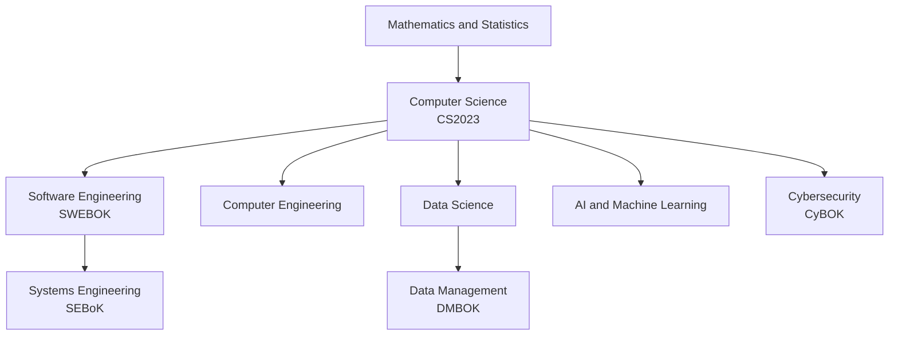

# Computing and Science BOK Frameworks

## Purpose

Use this reference when the user wants to organize Computer Science or science knowledge with the depth and explicit structure of SWEBOK. The first decision is not the folder name. It is the role of the source framework.

## Framework type decision table

| Type | Typical source | Strength | Limitation | Vault treatment |
|---|---|---|---|---|
| Professional BOK or standard | SWEBOK, SEBoK, CyBOK, DMBOK, BABOK, PMBOK | Defines professional knowledge areas, practices, roles, or processes | Usually not a complete academic sequence | Use as a BOK spine for the profession |
| Academic curriculum framework | CS2023, Computer Engineering Curricula, IT curricula, Data Science competencies | Defines learning areas, knowledge units, competencies, and curricular coverage | Describes curriculum guidance, not necessarily a professional standard | Use as an academic BOK-style spine and label it as a curriculum framework |
| Taxonomy or classification | ACM CCS, MSC2020, PhySH | Provides stable hierarchical indexing and terminology | Does not prescribe prerequisites or a learning path | Use for tags, search, and topic grouping |
| Core-concept or literacy framework | Vision and Change/BioCore, Earth Science Literacy Principles | Organizes big ideas and scientific competencies | May not enumerate every course topic or level | Use as the conceptual spine, then add a local progression |

## Recommended Computer Science spine: CS2023

CS2023 is the joint ACM, IEEE Computer Society, and AAAI Computer Science curriculum framework. It contains 17 knowledge areas. It is an excellent academic spine for a Computer Science vault, but the overview should call it a curriculum framework rather than implying that it is identical to SWEBOK.

| Code | Knowledge area |
|---|---|
| AI | Artificial Intelligence |
| AL | Algorithmic Foundations |
| AR | Architecture and Organization |
| DM | Data Management |
| FPL | Foundations of Programming Languages |
| GIT | Graphics and Interactive Techniques |
| HCI | Human-Computer Interaction |
| MSF | Mathematical and Statistical Foundations |
| NC | Networking and Communication |
| OS | Operating Systems |
| PDC | Parallel and Distributed Computing |
| SDF | Software Development Fundamentals |
| SE | Software Engineering |
| SEC | Security |
| SEP | Society, Ethics, and the Profession |
| SF | Systems Fundamentals |
| SPD | Specialized Platform Development |

Primary source: [CS2023 Knowledge Areas](https://csed.acm.org/knowledge-areas/).

Use the [CS2023 Final Report](https://csed.acm.org/final-report/) as the authoritative report, especially **Section 3: Body of Knowledge**. The official [HTML report](https://csed.acm.org/wp-content/uploads/2025/11/CS2023-Report.htm) and [Introduction to the Knowledge Model](https://csed.acm.org/wp-content/uploads/2024/04/1.3-Introduction-to-Knowledge-Model.pdf) define the structure as knowledge areas containing knowledge units, with topics and illustrative learning outcomes. Preserve the report's topic labels: **CS Core**, **KA Core**, and **Non-core**. A knowledge area also includes professional dispositions; it is not automatically equivalent to one course.

## Map existing computing notes before creating new ones

For a vault that already contains Software Engineering and computing foundation notes, use a matrix like this before writing a new overview:

| CS2023 area | Likely existing content to map | Typical action |
|---|---|---|
| AL | Algorithm and advanced algorithm notes | Reuse and add a CS overview link |
| AR | Computer organization and architecture | Reuse; normalize the overview name only if necessary |
| AI | Artificial Intelligence and machine learning notes | Reuse; separate general AI from AI-for-engineering material |
| DM | Database and data-management notes | Reuse; link to DMBOK for governance and management concerns |
| FPL | Programming Language Theory and compiler notes | Reuse; identify missing semantics, types, and translation topics |
| HCI | HCI, usability, accessibility, and cognitive-load notes | Reuse; preserve the human-factors boundary |
| MSF | Mathematics for Software Engineering, probability, and statistics | Create a coherent mathematical overview before adding many topic files |
| NC | Computer Networks and communication protocols | Reuse; link to CyBOK for network security |
| OS | Operating Systems notes | Reuse; keep distributed systems as a visible PDC connection |
| PDC | Distributed systems, concurrency, parallel computing | Consolidate scattered notes under an explicit area overview |
| SDF | Programming fundamentals, data formats, error handling, and basic development practice | Reuse; avoid confusing it with the full SE area |
| SE | SWEBOK and software-engineering notes | Link as a professional overlay rather than duplicating the notes |
| SEC | CyBOK and software-security notes | Link the security foundations while preserving CyBOK's broader scope |
| GIT | Graphics, visualization, games, and interactive media | Usually a gap area requiring a new overview |
| SEP | Computing ethics, law, society, accessibility, and professional responsibility | Usually cross-cutting; create one overview and link it throughout |
| SF | Basic system concepts, abstraction, state, and system organization | Reuse computing foundations and make the systems boundary explicit |
| SPD | Web, mobile, embedded, cloud, or other platform-specific development | Keep platform material as specializations rather than mixing it into core foundations |

## Keep the domains distinct

When the user chooses separate vaults for low coupling, assign each domain a canonical home and keep the boundary explicit. Use cross-vault links, stable GitHub paths, or bridge notes rather than copying complete topic notes into every related vault. A shared prerequisite such as algorithms or probability can be referenced by several domains without becoming a reason to merge the vaults.

Use cross-links rather than one giant merged BOK:

- **Computer Science** explains computation, algorithms, systems, and information-processing ideas.
- **Software Engineering** explains how to develop and maintain software responsibly at professional scale.
- **Systems Engineering** explains the whole system, including hardware, software, people, and processes.
- **Cybersecurity** explains how systems and information are protected against threats.
- **Data Management** explains how data is governed, modeled, integrated, protected, and maintained as an organizational asset.
- **Data Science** combines computing, mathematics, statistics, data management, and domain reasoning.
- **Computer Engineering** emphasizes hardware and the hardware-software boundary.

## Science framework choices

| Domain | Useful framework type | Recommended vault use |
|---|---|---|
| Mathematics | MSC2020 classification | Use as a taxonomy, then add prerequisite and progression layers |
| Physics | PhySH classification plus physics-program guidance | Use topic headings for indexing and build a mechanics-to-modern-physics progression |
| Chemistry | ACS undergraduate chemistry guidelines | Use as a curriculum anchor and organize topics by foundational chemistry and laboratory practice |
| Biology | Vision and Change plus BioCore | Use core concepts and competencies, then add cell, genetics, organismal, ecology, and laboratory strands |
| Earth Science | Earth Science Literacy Principles | Use Earth-system big ideas, then add geosphere, atmosphere, hydrosphere, biosphere, hazards, and human-impact progression |

Do not imply that one of these science frameworks is a universal national course sequence unless the source explicitly says so. Mark local topic ordering and extension topics as the vault's adaptation.

## Recommended build order

1. Create the CS2023 master overview and the 17-area mapping table.
2. Link existing computing-foundation, software-engineering, cybersecurity, and data-management notes into the relevant areas.
3. Create only the missing area overviews first, especially Graphics and Interactive Techniques, Society/Ethics/Profession, and Specialized Platform Development.
4. Add topic notes after the area structure is approved; keep detailed notes in the established content root rather than automatically placing them under `body-of-knowledge/`.
5. Build Data Science as an overlay on CS2023, mathematics/statistics, and DMBOK rather than duplicating those foundations.
6. Build Computer Engineering as an overlay on architecture, digital logic, embedded systems, and hardware-software interfaces.
7. Deepen AI/ML after the CS and mathematics foundations are stable.
8. Strengthen Physics, Chemistry, Biology, and Earth Science using each domain's appropriate framework instead of forcing all sciences into the same professional-BOK template.

## Verification checklist

- [ ] Source type is named correctly: BOK, curriculum framework, taxonomy, or literacy framework.
- [ ] Official source URL is recorded beside the framework description.
- [ ] Existing vault notes were inventoried before new files were planned.
- [ ] Every framework area has a mapping status: reuse, split, create, or pending.
- [ ] Existing notes are linked rather than copied without a reason.
- [ ] CS2023 area count and names match the official knowledge-area page.
- [ ] Science extensions and local progressions are labeled as adaptations.
- [ ] Overview links resolve against actual filenames.
- [ ] Completion claims count topic files, not only overview rows.

## Official source directory

- [CS2023 Knowledge Areas](https://csed.acm.org/knowledge-areas/)
- [ACM Curricula Recommendations](https://www.acm.org/education/curricula-recommendations)
- [CyBOK](https://www.cybok.org/)
- [SEBoK](https://sebokwiki.org/)
- [DAMA-DMBOK](https://dama.org/learning-resources/dama-data-management-body-of-knowledge-dmbok/)
- [ACM Data Science competencies](https://www.acm.org/binaries/content/assets/education/curricula-recommendations/dstf_ccdsc2021.pdf)
- [MSC2020](https://msc2020.org/)
- [PhySH](https://physh.org/)
- [ACS Undergraduate Chemistry Guidelines](https://www.acs.org/education/policies/acs-approval-program/guidelines.html)
- [BioCore Guide](https://pmc.ncbi.nlm.nih.gov/articles/PMC4041499/)
- [Earth Science Literacy Principles](https://www.earthscienceliteracy.org/)
- [Computer Engineering Curricula](https://www.acm.org/binaries/content/assets/education/ce2016-final-report.pdf)
- [Information Technology Curricula](https://www.acm.org/binaries/content/assets/education/curricula-recommendations/it2017.pdf)
- [Information Systems Curricula](https://www.acm.org/binaries/content/assets/education/curricula-recommendations/is-2010-acm-final.pdf)
