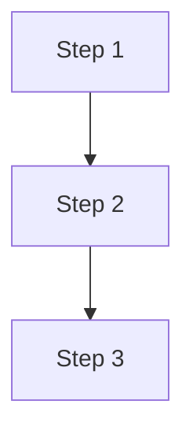
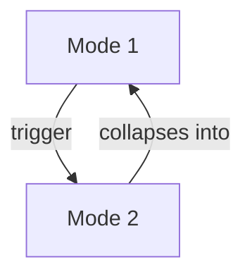
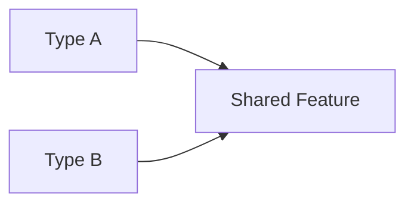
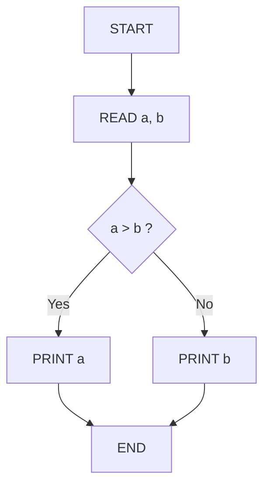
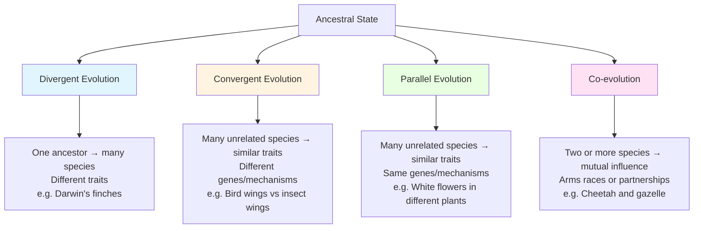

# Obsidian Note Authoring

Synthesize source material into structured, high-quality Obsidian notes. This skill covers the **authoring workflow** — reading source material, planning structure, writing with frontmatter/sections/diagrams/wikilinks, and validating completeness. For basic Obsidian CRUD operations (read, list, search, append), use the `obsidian` skill instead.

## When to use this skill

- User asks to summarize a book chapter, article, transcript, or document into an Obsidian note
- User provides specific formatting requirements (frontmatter tags, section hierarchy, wikilinks to related notes)
- User wants structured notes with diagrams, checklists, or cross-references
- Task involves creating knowledge base entries from domain material

## Workflow

### Step 0: Gather web sources (only when the user gives a topic, not sources)

When the user names a research question and a destination folder instead of providing material:

1. Run 3-4 complementary `web_search` queries in ONE turn (parallel calls): origin/history of the phenomenon, the psychology or theory behind it, the criticism/counterpoint, and current practice.
2. Pick 3-5 anchor sources and fetch them with `mcp__searxng__web_url_read` (load it via `tool_search` with query `searxng web url read`). Invoke `tool_call` with exactly ONE entry per call: MCP/local tools cannot share one `tool_call` batch (only `connectors__` tools batch); to fetch in parallel, issue one `tool_call` block per URL in the same assistant turn.
3. Oversized or paywalled sources (e.g. PDFs past the reader's size cap) may return only search-snippet evidence: cite only what was verifiably retrieved, and note the limited access in the reference. Never reconstruct unfetched source text.
4. When extraction output spills to a persisted file, mine it with `execute_code`: locate regions by searching several loose keywords to find offsets, then print window slices. Do not assume an exact opening phrase exists.
5. Record one APA-style reference per consulted source (author, year, title, venue, URL), then continue with Step 1 on the gathered extracts.

### Step 1: Read the full source material

- Read the ENTIRE source before writing anything — do not start writing after reading only the first portion
- For large sources (>1000 lines), read in parallel chunks (offset/limit) to speed up
- Note key structural elements: headings, case examples, data tables, process descriptions
- Identify content density — which sections are meaty vs. thin

### Step 2: Read destination folder conventions, then plan structure

When the note lands in an existing vault folder, read 2-3 notes already in that folder BEFORE writing — do not assume a generic template matches local conventions. Extract: naming pattern (kebab-case? numbered prefix?), frontmatter shape (inline `tags: [...]` vs multi-line, presence of a source/attribution line), recurring section signatures (TL;DR block, blockquote metadata header, "Key takeaways" footer, "Related"/"Knowledge connections" link section), diagram preference (Mermaid vs ASCII), and tone. Match these in the new note even if the user did not restate them — conventions are implied by the existing corpus, not re-declared each time.

Then mentally map:
- What sections does the user's format request specify, overlaid on the folder's conventions?
- Which source sections map to which note sections?
- Where will diagrams add value (processes, flows, comparisons, hierarchies)?
- What wikilinks to related notes are needed?
- Estimate word count — is the source rich enough to meet minimums?

### Step 3: Write the complete note

- Use `write_file` to create the full note in one pass when possible
- Include ALL requested elements: frontmatter, source attribution, sections, diagrams, checklists, wikilinks
- For very large notes (>4000 words target), write in stages: core structure first, then expand

### Step 4: Validate against requirements

After writing, verify:
- Word count meets any specified minimum (use `wc -w` in terminal)
- All requested sections are present
- YAML frontmatter uses correct format (inline tags: `tags: [tag1, tag2]`)
- Mermaid diagrams parse and lint: `scripts/mermaid_parse_check.mjs <note.md>` (real parser; setup: copy it beside a `node_modules` with `npm install mermaid jsdom`) plus `scripts/mermaid_check.py <file-or-dir>` for Obsidian quirks
- No em-dashes, arrow glyphs, ellipsis glyph, `§`, `≠`, or curly quotes in prose: user preference is colons, `->`, `...` (emoji and Thai script stay)
- Wikilinks use exact filenames specified by user
- No placeholder text or "TODO" markers remain

### Step 5: Expand if under target

If word count is below minimum:
- Identify which sections were condensed from rich source material
- Expand those sections with additional detail from the source
- Add new subsections for material you initially summarized briefly
- Use `patch` to insert expansions at the right locations
- Re-validate word count after expansion

## YAML Frontmatter Patterns

### Inline tags format (preferred for Obsidian)
```yaml
---
tags: [schema-therapy, narcissistic-personality-disorder, npd, psychology]
---
```

### Multi-line tags format (also valid)
```yaml
---
tags:
  - schema-therapy
  - narcissistic-personality-disorder
---
```

### Source attribution
Always include a source line after frontmatter:
```markdown
> *Source: [Full Title] by [Authors], [Chapter/Section] (pp. X-Y)*
```

## Section Structure Patterns

### Book chapter summary template
```markdown
# N — Chapter Title

## Purpose
## Key Concepts
### Concept 1
### Concept 2
## Clinical Techniques / Methods
## Case Vignettes / Examples
## Summary Checklist
## Related
```

### Series continuation note (joining an existing series)

```markdown
> **Created:** YYYY-MM-DD
> **Grew out of:** [[sibling-a]] and [[sibling-b]]
> **The question:** the question this note answers

# Title

## TL;DR
...

## Knowledge connections
- [[sibling-a]]: how it connects

## Key takeaways
```

Series notes link both ways (add backlinks to the siblings too). Confirm the exact header shape by reading the current notes in the destination folder first. For web-researched notes in the `personal/note` series the header reads `> **Created:** date`, `> **Why this note exists:**`, `> **Sources:** method (date)`, followed by `## TL;DR` and numbered sections ending in `## Knowledge Connections`, `## Key Takeaways`, and `## References (APA)`.

### Hierarchical breakdown guidelines
- Use `#` for the main title
- Use `##` for major sections
- Use `###` for subsections within Key Concepts
- Use `####` for sub-subsections when needed
- Bold key terms on first introduction
- Use tables for comparisons
- Use bullet lists for enumerations

## Character and style conventions (user preference)

- Colons over em-dashes in prose. Where a dash would read parenthetical, use a comma or a new sentence.
- No typographic exotics: write `->` / `<-` (not arrow glyphs), `...` (not the ellipsis glyph), `Section N` (not `§`), `is not` (not `≠`), straight quotes (not curly). The user has these replaced on sight, so don't introduce them.
- Keep emoji (✅ ⚠️) and legitimate non-Latin script: Thai in Thai-context sections is intended content, never strip it during cleanup. After writing Thai, scan non-ASCII and confirm glyphs read `THAI CHARACTER ...` (mixed Latin inside Thai words means mojibake). Also check the known sara-am artifact by codepoint: ความ written as คว + SARA AA (U+0E32) + MO MA is visually near-identical to correct ความ (SARA AM U+0E33); detect with unicodedata/codepoint comparison, not eyeballing, and remember it can be inherited verbatim from source notes you copied Thai from.
- When asked to clean a note, apply context-specific replacements (comma/period for parenthetical dashes) FIRST, then the generic em-dash -> `: ` pass, so the generic pass does not destroy the special cases; print every changed line and gate the write on a clean non-ASCII re-scan (`scripts/nonascii_scan.py <note.md>`).

## Mermaid Diagram Patterns

### Obsidian-safe Mermaid rules (HARD-WON — tested across vaults)

Obsidian's mermaid renderer has quirks that differ from GitHub/VS Code. These rules are **mandatory**:

1. **Use `flowchart` keyword, NOT `graph`** — `graph TD` silently fails or renders poorly in Obsidian; `flowchart TD` works reliably.
2. **NO parentheses `()` in node labels** — causes parse errors. Use `&#40;` / `&#41;` or rephrase the label.
3. **NO numbered dots like `"1."`** — Obsidian interprets the dot as a mermaid operator. Use `"1 "` or `"Step 1"`.
4. **NO ampersand `&` in labels** — use `and` instead.
5. **Use `["label"]` quoting consistently** — bare labels with spaces work but are fragile; quoted labels are safer.

Enforce these with the re-runnable checker `scripts/mermaid_check.py <file-or-dir>` — it extracts every ```mermaid block and flags `graph`, bare `()`, `"N."`, and `&`. Run it after writing any diagram-heavy note (a batch of 8 mode notes caught zero issues on first pass with it). The lint catches Obsidian-specific rendering quirks; for full syntax validation also run `scripts/mermaid_parse_check.mjs <note.md>`, which parses every block with the real mermaid parser and exits non-zero on failures (needs `mermaid` + `jsdom` installed in the directory you run it from).

### Process/flow diagrams


### Mode/state diagrams


### Comparison/classification diagrams


### Decision flowcharts (for problem-type solutions)


### Color-coded classification diagrams (for pattern/category explanations)


Use Mermaid when:
- Describing processes with sequential steps
- Showing state transitions or mode switches
- Illustrating relationships between concepts
- Comparing types or categories
- **Problem types that say "draw a flowchart" or "trace an algorithm"** — the solution should be a mermaid diagram, not ASCII art
- **Explaining classification patterns** — use color-coded boxes (blue, orange, green, pink) to make categories visually distinct

## Wikilink Conventions

- Use exact filenames specified by the user (do not alter casing or separators)
- Format: `[[Filename]]` or `[[Filename]] — Description`
- Place wikilinks in a dedicated `## Related` section at the end
- If user provides a list of exact filenames, use them verbatim
- Series notes link BOTH ways: when a new note joins an existing cross-linked series, read each sibling first, then append a backlink bullet to each sibling's link section (`## Knowledge connections` or `## Related`) in addition to linking siblings from the new note.

## Pitfalls

1. **Starting to write before reading the full source** — leads to missing key content that appears later; always read everything first
2. **Skipping the destination-folder read** — a generic template produces a note that clashes with local conventions (frontmatter shape, TL;DR block, link-section name); always read 2-3 sibling notes first and match their patterns
3. **Underestimating word count needs** — if target is 5000+ words, plan for ~1000 words per major section; expand aggressively from source detail
4. **Condensing rich source material too much** — case examples, dialogue excerpts, and specific techniques deserve full treatment, not one-line summaries
5. **Missing Mermaid diagram opportunities** — any time a process, flow, or state transition is described, a diagram adds value
6. **Forgetting to validate** — always check word count and section completeness after writing
7. **Using wrong frontmatter format** — user may specify inline vs. multi-line tags; follow their instruction exactly
8. **Wikilink filename mismatches** — user-specified filenames must be used exactly as given, including underscores and casing
9. **Expanding by adding fluff** — when expanding to meet word count, add substantive content from the source, not filler sentences
10. **Using `patch` on markdown tables** — the `patch` tool can corrupt Obsidian markdown table syntax, introducing double-pipe `||` artifacts on table rows. When editing tables (adding rows, updating cell content), prefer `write_file` to rewrite the entire file instead of `patch`. Reserve `patch` for non-table content (paragraphs, bullet lists, YAML frontmatter, headings) where it is reliable. Always verify table syntax with `read_file` after any table edit.
11. **Batching MCP/local tools into one `tool_call`** — `tool_call` accepts exactly one entry for local/MCP tools (only `connectors__` entries batch); parallel fetches need one `tool_call` block per invocation in the same turn.
12. **Summarizing sources that never fully loaded** — snippets get dressed up as citations; quote and paraphrase only what extraction actually returned, and mark partial access in the references.
13. **Grepping a persisted tool-output dump for one assumed lead phrase** — exact-phrase assumptions return empty; search several loose keywords to locate offsets first, then print window regions.
